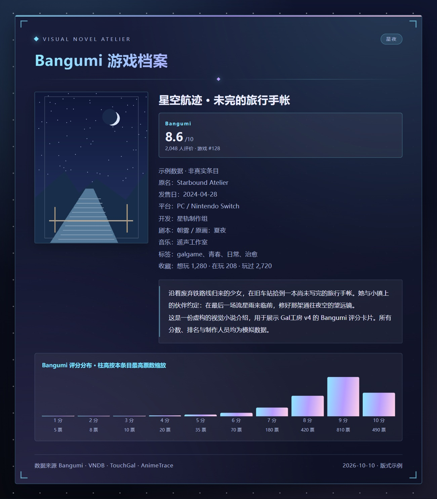
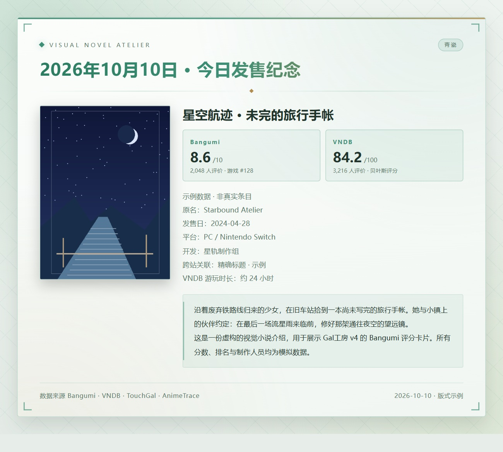
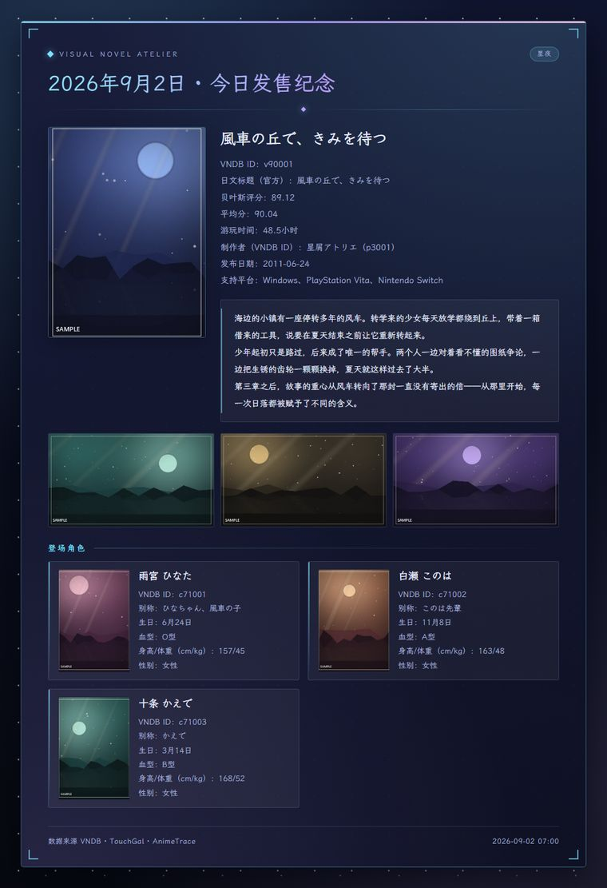
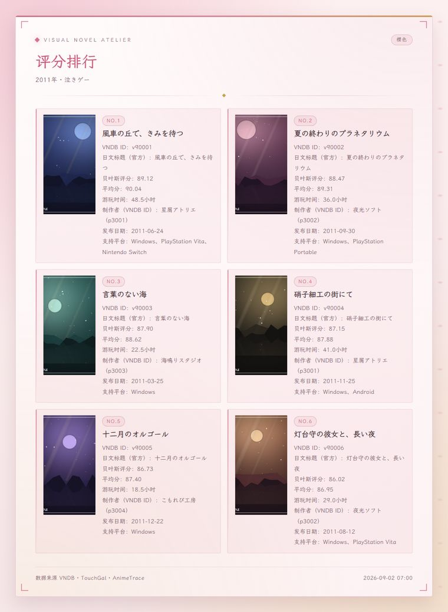
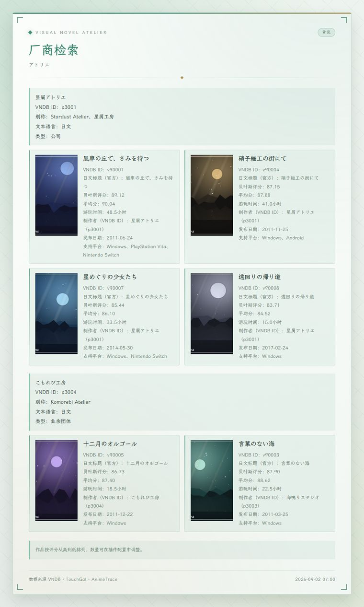
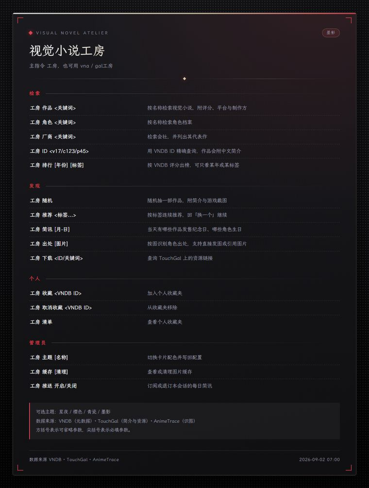

<div align="center">


<h1>Gal工房 · VN Atelier</h1>

<p><b>Bangumi 优先的 Galgame 资料与评分助手</b></p>

<p>
在群里查 Bangumi 游戏评分与资料、查角色与会社，看评分榜、随机抽一部、以图找出处，<br>
每条结果都渲染成一张排好版的图片卡片 —— 四套版式，四套配色。
</p>

<p>


</p>

</div>

---

## 预览

**v4 新增：评分档案与每日推送双来源评分。** 下图同样使用虚构作品、模拟评分和原创代码绘制封面，仅展示版式，不代表真实 Bangumi / VNDB 条目。





下面四张图是四种版式配四套主题的样子。图里的作品、角色、会社和简介**全部是虚构的示例数据**，
封面与游戏截图由脚本用渐变和几何图形现场绘制，不含任何第三方美术素材。

<table>
<tr>
<td width="50%"></td>
<td width="50%"></td>
</tr>
<tr>
<td align="center"><b>特写</b> · 星夜　随机抽取 / 标签推荐 / 每日简讯</td>
<td align="center"><b>画廊</b> · 樱色　作品检索 / 角色检索 / 评分排行</td>
</tr>
<tr>
<td width="50%"></td>
<td width="50%"></td>
</tr>
<tr>
<td align="center"><b>档案</b> · 青瓷　会社检索 / 今日简讯 / 出处识别</td>
<td align="center"><b>面板</b> · 墨影　帮助卡 / 收藏清单 / 缓存统计</td>
</tr>
</table>

版式由指令自动选择，配色随时可以换：`工房 主题 青瓷`。

## v4 升级须知：分数来自哪里？

- **以前的每日推送只有 VNDB 评分，没有 Bangumi 评分。** v4 默认补充 Bangumi；未成功关联时仍出原卡片，并说明未匹配、有歧义或暂不可用，**不是每一部作品都会有双评分**。
- **两站评分分别展示，不融合、不换算。** Bangumi 是 10 分制；VNDB 是 100 分制贝叶斯评分，算法、投票群体不同。未评分显示「暂无」，不是 0 分。
- **只读取 Bangumi 游戏条目。** 同名动漫不会被拿来补游戏评分。Bangumi 游戏库不止 Galgame，默认搜索和无标签榜单也可能出现其他类型游戏；榜单可加 `galgame` 标签收窄范围。
- **跨站关联采用保守规则。** 优先条目外链；没有可用外链时检查精确标题或别名，并在两边都有发售日期时核对年份。有冲突、续作名不同或多个精确候选时不猜。游戏版本划分与译名差异可能导致没有关联。
- **评分榜 ≠ 官方排名。** 榜单按 Bangumi API 评分排序并过滤最低评价人数；卡片里的「游戏 #排名」是原站提供的排名。无排名条目写「未排名」。
- **升级不改收藏与订阅。** 包名、数据目录不变；`工房 ID`、个人收藏依然使用 VNDB ID，不支持拿 Bangumi 数字 ID 收藏。每日选题和角色数据仍来自 VNDB，不改成全站热榜推送。
- **默认行为变化：** `工房 作品` 与 `工房 排行` 改为 Bangumi 优先。想看旧榜单用 `工房 VNDB排行`；想完全恢复原来源，在配置中关闭「启用 Bangumi」。Bangumi 榜单失败只提示重试，不自动换一份不同来源的榜单。

---

## 能做什么

- **Bangumi 优先** —— 作品关键词优先检索 Bangumi 游戏。`工房 BGM` 支持名称、数字 ID 或条目链接，详情展示评分、评价人数、游戏排名、1–10 分投票分布、简介、发售日、平台、开发及制作信息（以上字段以原站提供为准）。
- **角色与会社检索** —— 继续使用 VNDB。直接给 VNDB ID（`v17` / `c123` / `p45`）可以精确命中；作品卡片尝试补充 Bangumi 数据。
- **有得逛** —— 评分排行（可按年份和标签出榜，带最低票数门槛，冷门作品不会凭个别高分冲上来）、随机抽一部、按标签连续推荐（回一句「换一个」就换下一部）、以及「今天有哪些作品发售纪念日、哪些角色生日」。
- **以图找出处** —— 直接发图、引用一条带图的消息、贴图片链接，或者什么都不给（那就拿你的头像），交给 AnimeTrace 识别角色与出处。
- **资源查询** —— 按 ID 或关键词查 TouchGal 上的下载链接，结果用合并转发发出。
- **私人收藏夹** —— 每人一份，按「平台 + 用户」隔离，群成员之间互不干扰，单人上限 100 项。
- **每日简讯** —— VNDB 负责发售纪念与角色生日选题，作品资料优先补充 Bangumi。匹配成功时卡片并列展示 Bangumi / VNDB 评分；管理员在群里发「工房 推送 开启」即可订阅。
- **交给大模型** —— 可选注册四个函数工具：作品检索（Bangumi 优先）、Bangumi 查询、角色检索、厂商检索。工具返回注明来源的文字资料。

### 一些看不见但有用的设计

- **渲染失败会退回纯文本**，而不是丢一句报错了事。截图服务临时不可用时，同样的内容会用文字发出来。
- **图片两级缓存**：磁盘 + 内存，带容量上限、有效期和 LRU 淘汰，同一张封面不会反复下载。
- **指令冷却**：同一用户在冷却期内的重复指令会被静默忽略，避免刷屏和对外部 API 的滥用。
- **网络层统一重试与超时**：被站点按客户端指纹拦下时，自动换成浏览器 TLS 指纹重试；真撞上需要跑 JavaScript 的浏览器验证，则识别出来并把该站点熔断一段时间 —— 不做无意义的重试，也不把日志刷满。
- **数据源不通时会绕路**：TouchGal 被验证页拦住时，`工房 随机` 自动改用 VNDB 出结果，指令照常可用。
- **Bangumi 独立容错**：普通作品查询无结果或接口不可用时回退 VNDB；补充资料失败不阻断原有作品卡片。评分榜不静默换来源，避免把两站分数混在一起。
- **数据缓存与请求合并**：Bangumi 使用最多 256 项的内存缓存，同一请求合并，默认缓存 6 小时；不把每次群消息变成重复的全站查询。
- **渲染参数会自适应**：高清参数被老版本截图服务拒绝时，自动降级成保守参数重渲一次，而不是直接失败。
- **配置容错**：填错的数字会被收敛到合法区间并写进日志，插件不会因为一个配置项而加载失败。
- **干净的卸载**：停用或重载时会关闭连接池、注销定时任务与函数工具，不留悬挂的后台协程。

---

## 安装

需要 AstrBot ≥ 4.16、Python ≥ 3.10。

**方式一 · 插件市场（推荐）**

AstrBot WebUI → 插件市场 → 搜索「Gal工房」→ 安装。

**方式二 · 填仓库地址**

AstrBot WebUI → 插件管理 → 从 URL 安装，粘贴：

```
https://github.com/Whereis-Alice/astrbot_plugin_vn_atelier
```

**方式三 · 手动克隆**

```bash
cd AstrBot/data/plugins
git clone https://github.com/Whereis-Alice/astrbot_plugin_vn_atelier.git
```

然后在 WebUI 里重载插件。

依赖（`aiohttp`、`aiofiles`、`beautifulsoup4`、`pydantic`、`pillow`、`curl_cffi`）由 AstrBot 按 `requirements.txt` 自动安装。
装好之后发一句 `工房 帮助`，能收到帮助卡就说明一切就绪。

---

## 指令

主指令是 **工房**，也可以写 `vna`、`VNA`、`gal工房`。下表中 `<>` 是必填参数，`[]` 是可选参数。

### 检索

| 指令 | 别名 | 说明 |
| --- | --- | --- |
| `工房 作品 <关键词>` | 游戏 / vn | 优先 Bangumi 游戏搜索；无结果或不可用时回退 VNDB |
| `工房 BGM <关键词 / ID / 链接>` | bgm / Bangumi / 评分 | 查询 Bangumi 游戏；唯一结果或精确 ID 输出完整评分档案，多结果输出列表 |
| `工房 角色 <关键词>` | 人物 / character | 按名称检索角色档案 |
| `工房 厂商 <关键词>` | 作者 / producer | 检索会社或社团，并列出它的代表作 |
| `工房 ID <VNDB ID>` | id | 用 `v17` / `c123` / `p45` 精确查询，作品会附中文简介 |
| `工房 排行 [年份] [标签]` | 榜单 / ranking | 默认 Bangumi 游戏评分榜；关闭 Bangumi 后恢复 VNDB 榜单 |
| `工房 BGM排行 [年份] [标签]` | bgm排行 / Bangumi排行 | 明确使用 Bangumi，按评分及最低评价人数筛选 |
| `工房 VNDB排行 [年份] [标签]` | vndb排行 | 明确使用 VNDB 贝叶斯评分及最低票数筛选 |

### 发现

| 指令 | 别名 | 说明 |
| --- | --- | --- |
| `工房 随机` | random / 抽一部 | 随机抽一部作品，附简介与游戏截图 |
| `工房 推荐 <标签...>` | 标签 / recommend | 按标签连续推荐，回「换一个」继续，回「结束」收工 |
| `工房 简讯 [月-日]` | event / 今日 | 当天有哪些作品发售纪念日、哪些角色生日 |
| `工房 出处 [图片链接]` | 识别 / find | 以图识别角色与出处 |
| `工房 下载 <ID 或关键词>` | 资源 / download | 查询 TouchGal 上的资源链接 |

### 个人

| 指令 | 别名 | 说明 |
| --- | --- | --- |
| `工房 收藏 <VNDB ID>` | mark | 加入个人收藏夹 |
| `工房 取消收藏 <VNDB ID>` | unmark | 从收藏夹移除 |
| `工房 清单 [清空]` | 收藏夹 / collection | 查看收藏夹，带「清空」则全部清除 |
| `工房 帮助` | help / 菜单 | 展示完整指令表 |

### 管理员

需要 AstrBot 的管理员权限。

| 指令 | 别名 | 说明 |
| --- | --- | --- |
| `工房 主题 [名称]` | theme | 切换配色并写回配置；不带参数则列出可选主题 |
| `工房 缓存 [清理]` | cache | 查看缓存占用，带「清理」则立即清空 |
| `工房 推送 开启/关闭` | subscribe | 订阅或退订本会话的每日简讯 |

### 用起来大概是这样

```text
工房 作品 CLANNAD
工房 BGM 13                  用 Bangumi 游戏 ID 精确查详情
工房 BGM https://bgm.tv/subject/13
工房 厂商 Key
工房 ID v17
工房 排行 2024 galgame        Bangumi 游戏评分榜；也可以只写年份或标签
工房 VNDB排行 2016 百合       保留原来的 VNDB 榜单
工房 推荐 治愈 校园          之后回「换一个」看下一部，回「结束」停下
工房 简讯 06-24              指定日期，省略则查今天
工房 出处                    把图和指令一起发出，或者先发指令再补一张图
工房 收藏 v17
工房 主题 青瓷
```

---

## 配置

全部配置项都在 AstrBot WebUI 的插件配置页里，每一项都带详细说明，默认值可以直接用。下面只列出常改的部分。

**Bangumi 数据（优先来源）**

| 配置项 | 默认 | 说明 |
| --- | --- | --- |
| 启用 Bangumi | 开 | 作品查询与默认排行优先使用 Bangumi；关闭后恢复 VNDB 行为 |
| 补充已有卡片与每日推送 | 开 | 为 VNDB / TouchGal 作品关联 Bangumi；关闭不影响直接 BGM 查询 |
| Bangumi Access Token | 空 | 公开数据无需填写；受限条目可在 [Bangumi 官方页面](https://next.bgm.tv/demo/access-token) 生成。还需账号权限及 NSFW 开关，不保证所有条目可读 |
| Bangumi 单次超时（秒） | 12 | 独立于通用网络超时；跨站匹配总等待最多约此值 + 4 秒 |
| Bangumi 数据缓存（小时） | 6 | 分数不是实时数据；重载清空。未匹配缓存最多 30 分钟，临时失败更早重试 |
| Bangumi 搜索结果上限 | 8 | 1–12 条 |
| BGM评分榜最低评价人数 | 100 | 只影响默认 Bangumi 榜单和 BGM排行，不影响普通搜索 |

Bangumi 使用官方 `api.bgm.tv` 接口，不需要浏览器、FlareSolverr 或 Cloudflare Worker。它遵循本插件的 HTTP/HTTPS 代理设置；若你的出口无法访问该接口，需自行配置可用网络。访问令牌仅用于该接口，不发送给图片服务器或其他来源。

**通用设置**

| 配置项 | 默认 | 说明 |
| --- | --- | --- |
| 单次请求最大尝试次数 | 5 | 图片或数据经常下载失败时可以调高，代价是响应变慢 |
| 单次请求超时（秒） | 30 | 网络慢或走代理时建议 45 以上 |
| 会话等待超时（秒） | 60 | 推荐、出处等指令等待你下一条消息的时长 |
| 合并转发单条包含的消息数 | 10 | 单条转发内容太多容易被平台拒收，0 表示不拆分 |
| 下载资源最多展示条数 | 0 | 0 表示全部列出 |
| 渲染失败时退回纯文本 | 开 | 建议保持开启 |

**外观与渲染**

| 配置项 | 默认 | 说明 |
| --- | --- | --- |
| 配色主题 | 星夜 | 星夜（深蓝夜空）/ 樱色（淡粉暖调）/ 青瓷（素雅冷绿）/ 墨影（高对比黑金） |
| 字体来源 | 在线字体 | 在线字体观感最好但要能访问 CDN；也可以改用系统字体或交给浏览器默认值 |
| 在线字体 CSS 地址 | 霞鹜文楷 jsDelivr | CDN 不通时可换国内镜像 |
| 字体名称 | LXGW WenKai | 用系统字体时改成本机确实装了的中文字体 |
| 清晰度 | 高清（1.3x） | 给渲染页面装一块高分屏。觉得字发虚就调到超清，详见常见问题里的对照表 |
| 图片格式 | JPEG | PNG 无损但体积大一倍以上，一般不需要换 |
| 图片质量 | 95 | JPEG 压缩质量，调低可以让发图更快；选 PNG 时该项不生效 |
| 显示页脚 | 开 | 图片底部的数据来源与生成时间 |

**网络与内容分级**

| 配置项 | 默认 | 说明 |
| --- | --- | --- |
| 允许 R18 内容 | 关 | 关闭时过滤成人向作品与图片 |
| 代理地址 | 空 | 只作用于本插件，例如 http://127.0.0.1:7897，支持 http / https / socks5 |
| TouchGal 站点地址 | https://www.touchgal.ink/ | 站点换域名时改这里，不用等插件更新 |
| TouchGal 登录 Token | 空 | 留空只能看到公开资源，取法见下面的常见问题 |
| Cloudflare cf_clearance | 空 | TouchGal 的临时凭证，只填值本身；迁移、过期或环境变化可能失效，与 Bangumi 无关 |
| 浏览器 User-Agent | 空 | 只在填了 cf_clearance 时需要，必须来自同一个浏览器；留空则按下面的指纹档位自动推一个 |
| 浏览器验证求解服务 | 空 | 可选 FlareSolverr 服务，不保证通过所有站点验证 |
| TLS 浏览器指纹 | chrome136 | curl_cffi 伪装用的浏览器标识，绕不过需要执行 JavaScript 的验证页 |

**每日推送**

| 配置项 | 默认 | 说明 |
| --- | --- | --- |
| 推送时间 | 07:00 | 24 小时制 HH:MM，格式错误会退回默认值并写日志 |
| 选取作品的口味 | 评分优先（排除冷门） | 也可以选纯评分优先或热度优先 |
| 生日角色性别筛选 | 不筛选 | 可只推女性或只推男性角色 |
| 启用群聊自助订阅 | 开 | 开启后管理员可以在群里直接订阅 |
| 推送白名单 | 空 | 手动指定会话，每行一条，格式「平台id-群聊id」，如 aiocqhttp-123456789 |

**缓存与限流**

| 配置项 | 默认 | 说明 |
| --- | --- | --- |
| 磁盘缓存上限（MB） | 256 | 超出后按最久未使用顺序删除，0 表示不限 |
| 缓存有效期（天） | 14 | 0 表示永不过期 |
| 内存缓存条数 | 64 | 命中时连磁盘都不用读，0 表示关闭 |
| 同一用户指令冷却（秒） | 3 | 0 表示不限制 |
| 开放给大模型调用 | 关 | 开启后注册作品、Bangumi、角色、厂商四个查询工具 |

**各指令的细节**

| 配置项 | 默认 | 说明 |
| --- | --- | --- |
| 角色卡附加信息 | 血型 / 身高体重 / 性别（不剧透） | 还可勾选三围、罩杯、含剧透的性别 |
| 每个厂商展示的作品数 | 9 | 按评分降序取前 N 部，0 表示全部 |
| 榜单展示条数 | 12 | — |
| 最低投票数门槛 | 100 | VNDB 榜单专用；Bangumi 使用上面的独立门槛 |
| 推荐预取数量 | 5 | 提前渲染几部，回「换一个」时几乎不用等 |
| 每个检测框的候选数 | 3 | 识图时每张脸给出几个候选角色 |
| 简讯作品质量门槛 | 75 | 只统计贝叶斯评分不低于此值的作品 |
| 简讯回溯起始年份 | 1990 | 想翻更早的老作品可以往前调 |

---

## 常见问题

<details>
<summary><b>只收到纯文本，图片发不出来</b></summary>

图片渲染走的是 AstrBot 自带的截图服务，插件只是把 HTML 交给它。收到纯文本说明渲染这一步失败了，兜底逻辑生效了。
到 AstrBot 日志里搜 `[Gal工房]` 看具体原因，最常见的是宿主机不能访问截图服务，或者一次要渲染的封面太多导致超时 —— 后者可以把「每个厂商展示的作品数」「榜单展示条数」调小。

</details>

<details>
<summary><b>图里的中文变成方框，或者字体很难看</b></summary>

默认用的是 CDN 上的霞鹜文楷。如果渲染环境访问不了 jsDelivr，就会退回系统字体；而很多 Linux 容器里根本没装中文字体，于是全成了方框。
两种解法：把「在线字体 CSS 地址」换成一个能访问的镜像；或者把「字体来源」改成系统字体，再把「字体名称」填成宿主机上确实装了的字体
（Windows 是 `Microsoft YaHei`，Linux 上常见 `Noto Sans CJK SC`；容器里可以先 `apt install fonts-noto-cjk`）。

</details>

<details>
<summary><b>「工房 下载」查不到资源，或者日志里全是 403</b></summary>

TouchGal 有 Cloudflare 防护，403 分两种，处理方式完全不同。先到日志里搜 `[Gal工房]` 对号入座：

**一、只是被客户端指纹拦下** —— 日志出现「转用浏览器指纹重试」，之后请求正常。

站点会拒绝「看起来不像浏览器」的请求。插件收到 403 后会自动换用 `curl_cffi` 模拟真实浏览器的 TLS 指纹重试一次，
所以只要确认 `curl_cffi` 装上了（`pip install curl_cffi`），这一类基本自动解决；还不行可以在「TLS 浏览器指纹」里换个型号。

**二、站点开启了浏览器验证** —— 日志出现「开启了浏览器验证」。指纹伪装对它无效，多半是服务器出口 IP 的信誉问题，见下一条。

另外，要看需要登录才可见的资源（含 R18）得填 Token：浏览器登录 https://www.touchgal.ink/ ，
从 Cookie 里复制 `kun-galgame-patch-moe-token` 的值，粘到「TouchGal 登录 Token」。
站点日后换域名也不用等插件更新，把新地址填进「TouchGal 站点地址」即可。

</details>

<details>
<summary><b>站点开启浏览器验证怎么办</b></summary>

日志出现「开启了浏览器验证」、响应头带 `cf-mitigated: challenge`，或正文是 `Just a moment...` 页面，表示站点要求浏览器验证。普通重试通常无法解决。出口 IP、客户端环境、请求行为和站点策略都可能影响结果，不能只凭 403 确定是哪一项。

**换服务器后，先核对当前实例的配置。** 升级插件或部署 Worker 都不会自动改掉「TouchGal 站点地址」。如果日志仍指向 `www.touchgal.ink`，请求仍在直连；要使用自己已经部署的 Worker，需要填入它的完整地址（含访问口令路径），并建议把「单次请求超时」设为 60 秒。不要公开包含口令的地址。

可选配置及限制：

| 方式 | 适用情况与限制 |
| --- | --- |
| 已有代理 | 在「代理地址」填写自己管理且可正常访问站点的代理；是否可用以服务器实际请求为准。 |
| 已有 Browser Rendering Worker | 部署与配置见 [可选 Worker 组件](extras/cf-worker-relay/)。浏览器运行在 Cloudflare，服务器不需要额外运行 Chrome。受免费额度、冷启动及站点策略限制，不保证长期可用。 |
| FlareSolverr | 在「浏览器验证求解服务」填自己管理的服务地址；浏览器占用额外内存，凭证仍可能失效。它不是唯一方案，也不保证通过所有验证。 |
| 手填 `cf_clearance` | 仅作临时凭证。尽量保持取值时的出口和浏览器 UA；迁移后旧值可能失效，反复粘贴同一值没有帮助。 |

**手填 Cookie 的注意事项：** 只填值本身；不要带 `cf_clearance=` 前缀或整段 Cookie（误填时插件会尝试截取）。「浏览器 User-Agent」填取值浏览器的 UA。没有填 UA 只表示无法确认一致性，并不等于已证实 UA 不匹配。日志里的签发时间是根据 Cookie 格式推测的，不能据此判断确切有效期；已经请求失败的旧值可以清空。

**普通反代的测试结果不能泛化。** 此前测试中的普通 Worker 仍返回 403；诊断端点显示 `tls=off`，只说明该请求路径暴露出的连接信息，不能据此断定所有 Worker、nginx 或代理都必然失败。Browser Rendering 版本曾测试成功，也仍需在实际部署环境中验证。

**免费额度不等于固定查询次数。** 此前 Workers Free 计划提供每天 10 分钟浏览器时长，以 [Cloudflare 当前限制](https://developers.cloudflare.com/browser-rendering/platform/limits/) 为准。浏览器保活等待也会消耗额度：一次查询耗时 10 秒，再保活 30 秒，就不能只按 10 秒估算。缓存有助于减少消耗，但不适合承诺「每天几十次很宽裕」。

插件命中验证后会对该站点冷却 300 秒，避免短时间刷屏。`工房 随机` 会尝试 VNDB 兜底；每日简讯获取 TouchGal 简介失败时，仍会尝试输出其余内容。`工房 下载` 依赖 TouchGal，必须恢复该来源才能正常获取资源。

</details>

<details>
<summary><b>图片不够清晰，怎么调</b></summary>

「清晰度」调的是渲染时的设备像素比，相当于给渲染页面换一块高分屏：版式一模一样，但字和封面的实际像素更多。
卡片的排版宽度固定是 1000 CSS 像素，所以输出宽度就是 1000 乘以倍率；高度随内容长短变化。

下面是同一张「今日推荐」卡片（封面 + 3 张游戏截图 + 4 张角色立绘）的实测值：

| 清晰度 | 输出宽度 | 单张体积 |
| --- | --- | --- |
| 标准（1x） | 1000 px | 约 280 KB |
| 高清（1.3x，默认） | 1300 px | 约 430 KB |
| 超清（1.8x） | 1800 px | 约 700 KB |
| 超清 + PNG | 1800 px | 约 2.8 MB |

这已经是最长的一种版式，指令表、排行榜之类的短卡片会明显更小。

日常用默认的高清就够 —— 聊天平台大多会对图片再压一次，清晰度的收益主要体现在放大看小字的时候。
觉得字发虚、或者想截图存档，调到超清。

「图片格式」建议保持 JPEG。PNG 是无损的，但从上表能看出体积会翻到四倍，部分平台会二次压缩甚至直接拒收大图，
除非确实要留无损存档，否则不划算。「图片质量」默认 95，是画质与体积的平衡点，降到 80 以下文字边缘会开始出现噪点。

如果宿主的截图服务版本较老、不认这些参数，插件会自动用一套保守参数重渲一次，并在日志里留一条警告 ——
结果只是清晰度回到标准水平，不会因此发不出图。

</details>

<details>
<summary><b>每日简讯没有推</b></summary>

按顺序检查：

1. 推送时间的格式必须是 `HH:MM`；
2. 目标群里执行过 `工房 推送 开启`，或者配置里的推送白名单填了 `平台id-群聊id`；
3. AstrBot 的定时任务模块在你的部署形态下可用 —— 取不到时插件会跳过定时功能，并在启动日志里说明。

</details>

<details>
<summary><b>有的作品查不到，或者搜出来的名字对不上</b></summary>

`工房 作品` 默认搜索 Bangumi 游戏，没结果才回退 VNDB。可以尝试中文名、日文原名或罗马音；已知条目时，`工房 BGM 13` 或 `工房 ID v17` 分别精确查询两个来源。两站对本体、移植版与续作的划分可能不同，没有关联评分并不表示插件漏了评分字段。

</details>

<details>
<summary><b>能和原来的 astrbot_plugin_galgame_box 一起装吗</b></summary>

可以。插件名、指令与别名、数据目录、定时任务名、配置分组全部是独立的，两个插件同时启用不会互相覆盖。
唯一要注意的是它们都会向 VNDB 和 TouchGal 发请求，别在同一个群里同时刷。

</details>

<details>
<summary><b>R18 内容怎么处理</b></summary>

默认关闭，成人向作品与图片会被过滤。开启前请自行确认所在群聊与平台允许此类内容 —— 这部分风险由部署者承担。

</details>

---

## 参与开发

仓库自带一份离线自检：不联网、不需要跑起来的 AstrBot 实例，几秒钟就能确认改动没把渲染管线弄坏。

```bash
python tests/test_smoke.py     # 也可以用 pytest tests
python tests/test_bangumi.py   # Bangumi 数据、匹配、HTTP 及推送管线的离线回归
```

它会导入全部模块、校验模板锚点与主题／版式清单、把各种畸形配置喂给设置解析器，
再用 Jinja 把四种版式 × 四套主题各渲染一遍，确认清晰度与风控相关的参数都会收敛到合法值，
并确认用户数据里的 `<script>` 无法越出页面。
Bangumi 回归覆盖跨站外链／别名、同名歧义与续作拒绝、无评分、限流冷却、取消共享请求、榜单门槛及每日推送；HTTP 测试仅连接本机临时端口，不访问第三方站点。
提 PR 前请顺手跑一下 `ruff check .` 与 `ruff format .`。

`extras/` 目录放的是可选的外部组件，不会被插件加载，也不参与自检 —— 目前有一个
[Cloudflare Worker 组件](extras/cf-worker-relay/)，可用于处理 TouchGal 的浏览器验证，不保证可用，也不参与 Bangumi 查询。

---

## 数据来源

| 来源 | 用途 |
| --- | --- |
| [Bangumi](https://bgm.tv/) | 优先的游戏名称、评分（10分制）、投票分布、游戏排名、简介、制作数据与收藏统计 |
| [VNDB](https://vndb.org/) | 作品、角色、会社的元数据，评分、发售日期与标签 |
| [TouchGal](https://www.touchgal.ink/) | 中文简介、游戏截图、资源链接 |
| [AnimeTrace](https://www.animetrace.com/) | 以图识别角色与出处 |

这些都是第三方公益或商业服务，请遵守各自的使用条款，不要拿本插件做高频抓取。

---

## 许可与衍生声明

本项目以 **AGPL-3.0** 授权，全文见 [LICENSE](LICENSE)。

本插件是 [PyuraMazo/astrbot_plugin_galgame_box](https://github.com/PyuraMazo/astrbot_plugin_galgame_box) 的衍生作品。
功能设计与最初的实现思路来自该项目；在此基础上，本仓库重写了代码分层、更换了全部插件标识符与指令，
修复了一批网络层与生命周期上的问题，并新增了评分排行、收藏清单、主题切换、缓存管理、群聊自助订阅等功能。
原项目同为 AGPL-3.0，其署名与版权声明依许可证要求保留。

原插件内置的美术素材没有沿用。本仓库的 logo、四套主题样式、图片缺失时的占位图，
以及预览图里的示例封面与截图，都是用代码现场绘制的原创素材；正文字体通过 CDN 引用，未打包进仓库。

完整的改动记录见 [CHANGELOG.md](CHANGELOG.md)。

---

<div align="center">
<sub>如果这个插件帮上了忙，欢迎给个 Star。发现问题请开 Issue，附上 AstrBot 日志里带 [Gal工房] 的那几行会快很多。</sub>
</div>
