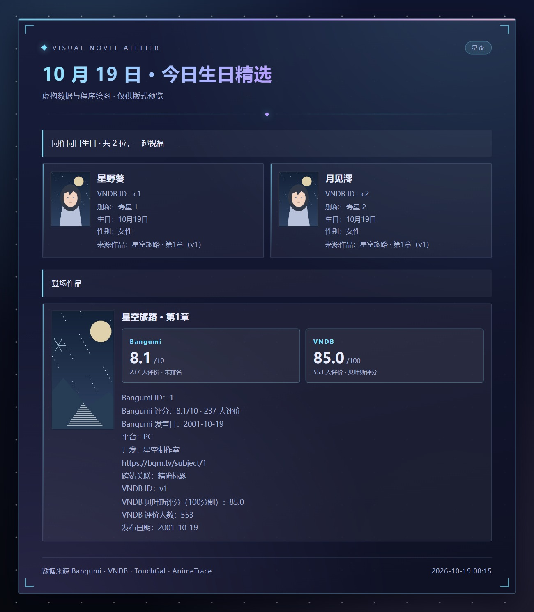
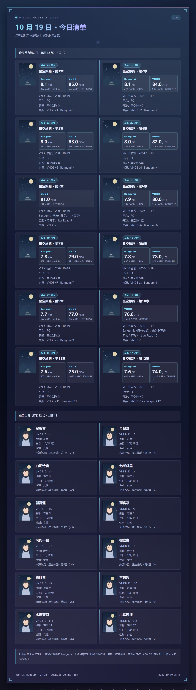
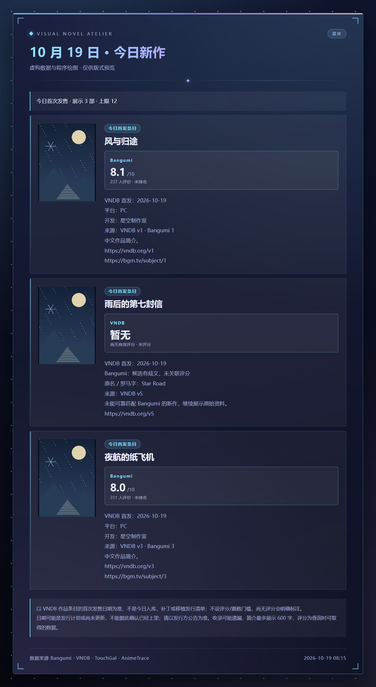

# 卡片预览

[返回首页](../README.md) · [配置指南](configuration.md)

以下展示评分档案、每日简讯，以及四种版式与配色。所有作品、角色、会社、简介和评分都是虚构示例，不代表真实 Bangumi / VNDB 条目。封面与截图由代码绘制，不含第三方美术素材。

## 独立推送栏目

精选、清单、新作分别发图，不拼成一张精选卡。开启方式与来源见[每日推送说明](daily-push.md)。

## 版式与配色

<table>
<tr>
<td width="50%"></td>
<td width="50%"></td>
</tr>
<tr>
<td align="center"><b>特写</b> · 星夜　随机抽取 / 标签推荐 / 每日简讯</td>
<td align="center"><b>画廊</b> · 樱色　作品检索 / 角色检索 / 评分排行</td>
</tr>
<tr>
<td width="50%"></td>
<td width="50%"></td>
</tr>
<tr>
<td align="center"><b>档案</b> · 青瓷　会社检索 / 今日简讯 / 出处识别</td>
<td align="center"><b>面板</b> · 墨影　帮助卡 / 收藏清单 / 缓存统计</td>
</tr>
</table>

版式由指令自动选择，配色随时可以换：`工房 主题 青瓷`。
